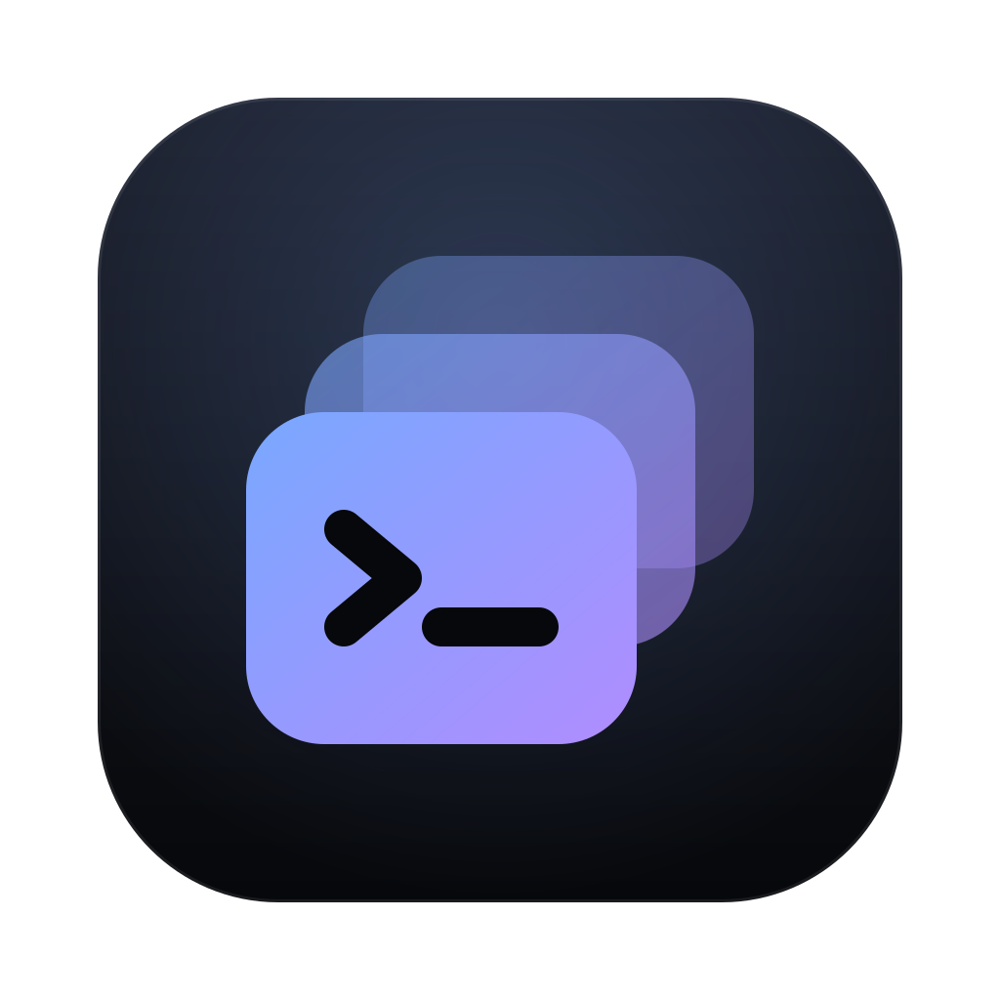
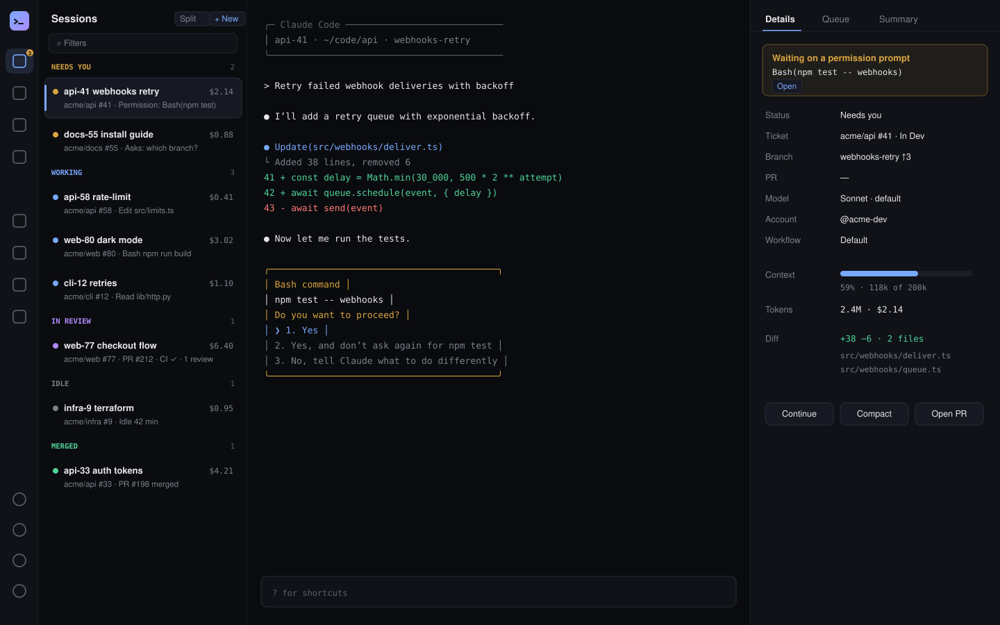
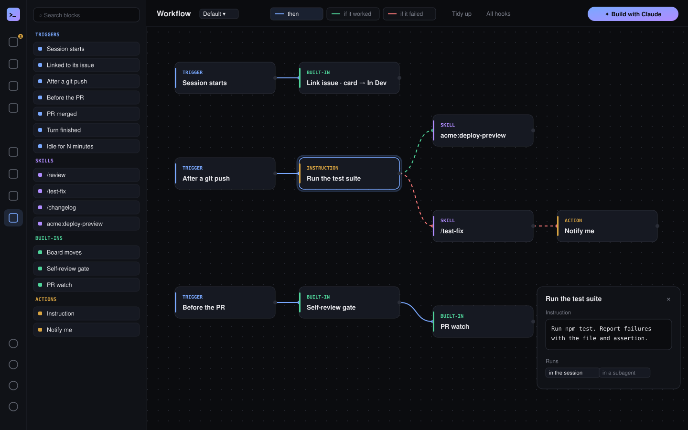
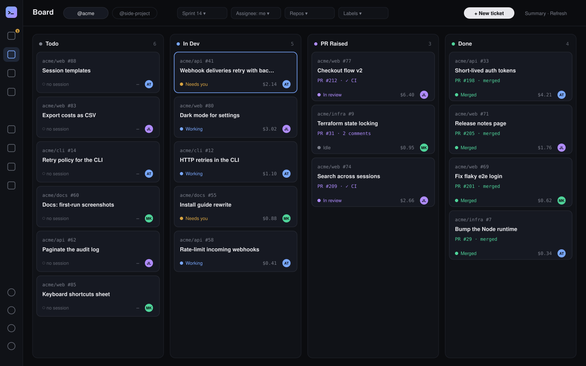
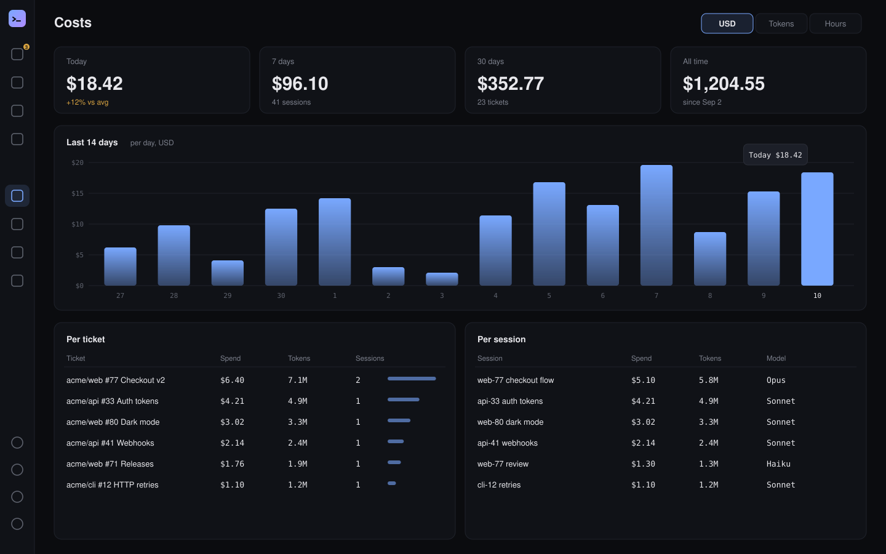
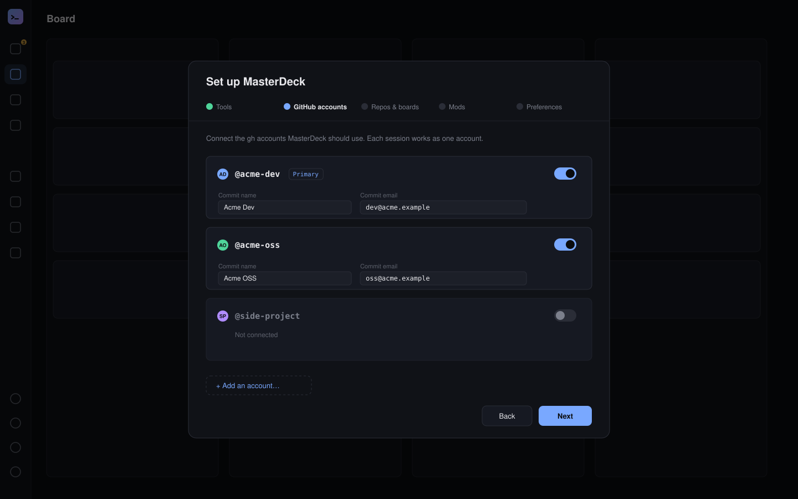

<div align="center">



# MasterDeck

**Run ten Claude Code sessions like you run one.**

Every [Claude Code](https://claude.com/claude-code) session in one window, next to your GitHub board,
your PRs and what each one costs. MasterDeck tells you which session needs you, starts sessions from
tickets, and takes each one from issue to merged PR.

[](https://github.com/amntoppo/MasterDeck-Terminal/releases/latest)
[](LICENSE)
[](#install)
[](https://github.com/amntoppo/MasterDeck-Terminal/actions/workflows/ci.yml)

[Website](https://masterdeck.dev) · [Quick start](#quick-start) · [Download](https://github.com/amntoppo/MasterDeck-Terminal/releases/latest) · [Guide](docs/GUIDE.md) · [Changelog](https://masterdeck.dev/download/#changelog)

<!-- Placeholder: a drawing of the Terminals view. Replace docs/images/sessions-list.svg with a real screenshot or GIF. -->


</div>

## Why MasterDeck

Claude Code works best with several sessions running at once. Then the work moves to you: which
terminal is waiting on a prompt, which ticket is it on, did its PR get a review, what did it cost?

- **See what needs you.** Sessions waiting on a prompt or a question, failing CI, idle work, context
  and budget warnings: one list, each with a one-click action.
- **Start work from tickets.** Click an issue on the Board and press Start: a session opens in the
  right checkout, linked to the issue, and its card moves as the work does.
- **Let it run to the merge.** MasterDeck links sessions to issues, moves board cards, gates the
  first PR behind a self-review, and sends review comments, conflicts and the merge back to the
  session.
- **Stay in control.** Nothing is sent to a session or started without your yes. No telemetry; it
  works through your own `claude` and `gh`.

## Features

> The images below are drawn placeholders, to be replaced by real screenshots.

### Workflows and agent loops

Build what every session does, from an issue to a merged PR, on a canvas: triggers (session starts,
after a push, PR merged, a command matched), your skills, instructions and MasterDeck's built-ins,
joined by *then*, *if it worked* and *if it failed*. A **loop** repeats its steps until a check
command passes or the agent says it is done, within the limits you set. Or ask **Build with
Claude** to draw the workflow for you. [More](docs/GUIDE.md#keeping-many-sessions-moving)



### Tasks and the board

Your sprint from GitHub Projects as a Kanban board, with the session, PR and spend on each card.
Assign tickets, start sessions for them, and create new ones with Claude. No GitHub project? The
Board works out columns from your repositories' issues, and **Create a GitHub board** makes a real
one. [More](docs/GUIDE.md#board-view)



### Sessions

Every session is a tab with its real `claude` terminal, grouped into Needs you, Working and In review.
The **master-agent**, pinned on the right, watches the others and your GitHub and proposes work for
you to approve. Notes, standups from your commits, a worktree janitor, history search and broadcast
are one click away. Switch on Remote to reach it all from a browser or a phone at
[app.masterdeck.dev](https://app.masterdeck.dev), end-to-end encrypted.
[More](docs/GUIDE.md#starting-and-linking-sessions)


### Costs

Spend and tokens today, over 7 and 30 days, per ticket and per session, from the sessions'
transcripts and Claude Code's status line. **Hours** estimates time worked per GitHub account, day
and ticket, with CSV export. [More](docs/GUIDE.md#cost-and-context)



### Several GitHub accounts

Work for more than one organization with different `gh` logins. Connect them in Setup, and each
session, Board tab and PR tab works as one account, with its own token and commit identity. Tokens
never leave your Mac, and MasterDeck never runs `gh auth switch`.
[More](docs/GUIDE.md#several-github-accounts)



## Quick start

**1. Install the tools** MasterDeck works with: [Claude Code](https://docs.claude.com/en/docs/claude-code)
(logged in), the [GitHub CLI](https://cli.github.com), Python 3.9+, `git` and `jq`. On macOS:

```bash
curl -fsSL https://claude.ai/install.sh | bash
brew install gh jq python git
```

(Skip this and Setup offers to install what is missing.)

**2. Log in to GitHub** with access to project boards:

```bash
gh auth login
gh auth refresh -s project
```

**3. Install MasterDeck.** On macOS (Apple silicon and Intel):

```bash
curl -fsSL https://raw.githubusercontent.com/amntoppo/MasterDeck-Terminal/main/install.sh | bash
```

It installs the latest release in `/Applications` and opens it. On Windows, download
`MasterDeck Setup <version>.exe` from [Releases](https://github.com/amntoppo/MasterDeck-Terminal/releases/latest).

**4. Follow Setup.** It opens by itself: check the tools, connect your GitHub accounts, tick the
repositories and boards you work on, and choose the folder your repositories are in. Or press
**Let Claude do it**: Claude does the same with you in a chat inside Setup, and you press **Save**
on the summary it shows.

**5. Start a session.** Open the Board, click one of your tickets and press **Start** in the dialog
that opens, or press **Start master**
on the right and let the master-agent propose work.

## Install

**macOS:** the one-line installer above downloads the right build from the latest
[release](https://github.com/amntoppo/MasterDeck-Terminal/releases). Run it again to update. The app
is not signed by Apple; a DMG downloaded in a browser is blocked until you allow it in **System
Settings → Privacy & Security → Open Anyway**, but a download by `curl` is not, so this needs no such
step. See [install.sh](install.sh).

Or download a build from [Releases](https://github.com/amntoppo/MasterDeck-Terminal/releases):

- **macOS:** `MasterDeck-<version>-arm64.dmg` for Apple silicon, or `MasterDeck-<version>.dmg` for
  Intel. macOS blocks it the first time: **System Settings → Privacy & Security → Open Anyway**.
- **Windows:** `MasterDeck Setup <version>.exe`. It is not signed, so SmartScreen asks you to
  confirm: **More info**, then **Run anyway**.

Or build it yourself (see [Contributing](#contributing)).

<details>
<summary><b>First run, step by step</b></summary>

1. **Skills.** MasterDeck copies its skills into `~/.claude/skills/`. It skips any skill folder
   you already have. Settings lists each skill's state and can replace a copy with the bundled one.
2. **Setup** opens by itself:
   1. **Tools.** Each of `claude`, `gh`, Python, `git` and `jq` is checked. Without Claude Code, the
      step shows its install command (`curl -fsSL https://claude.ai/install.sh | bash`, or the
      PowerShell one on Windows) with a Copy button. For the others, **Install now** opens a Claude
      session in the dialog that installs them (Homebrew on macOS, winget on Windows); you approve
      its steps there. Missing tools are checked again every few seconds and turn green once
      installed.
   2. **GitHub accounts.** Every account `gh` is logged in to, each with a switch: connect the ones
      MasterDeck should use (the active one is connected already). Each connected account has a name
      and email for its commits (from GitHub, editable) and, with two or more, a **Primary** choice
      (master, plain shells and sessions outside your repos use it). **Add an account…** runs
      `gh auth login --web` right there. MasterDeck never changes `gh`'s active account.
      With two or more accounts, MasterDeck keeps a token file per account in
      `~/.claude/masterdeck/accounts/` (mode 600) and starts each session with it; tokens never leave
      your Mac. GitHub.com only. See [Several GitHub accounts](docs/GUIDE.md#several-github-accounts).
   3. **Repos & boards.** One read lists every organization `gh` can reach, with its repositories and
      project boards. Tick the repositories whose issues you work on and the boards that track them (or
      **Select all** for either), and pick the primary repository (a plain `#12` means an issue there).
      MasterDeck reads each board's statuses and guesses what each means (ready, in progress, PR raised,
      done); adjust the guesses per board if they are wrong. No board: you still get issues, PRs and
      sessions, and the Board shows the ticked repositories' issues in columns MasterDeck works out
      (see [Board View](docs/GUIDE.md#board-view)). With two or more accounts, an **Account** menu
      picks whose repositories and boards you are choosing; a repository can be under one account
      only (others show it as "in <login>").
   4. **Mods.** Optional: **Install mods** puts MasterDeck's Claude Code mods (the ticket line above
      the prompt, alerts, `/md-note`, `/md-loop`, `/md-board`) into Claude Code for your user, at once
      (Claude Code 2.1.287 or later; `~/.claude/settings.json` is backed up first). See
      [MasterDeck's mods](docs/GUIDE.md#masterdecks-mods).
   5. **Preferences.** The folder master and new shells start in (where your repos are; with two or
      more GitHub accounts, also a folder for each other account's repos), whether to use a
      master-agent, and notifications for new Needs-you items.

   Later, Settings → **Set up MasterDeck** opens the same sections as one page: change any of them
   and Save (Mods installs or removes at once).

   Then the **Skills** popup (later: 🧩 Skills in the sidebar) lists the bundled skills: add or
   remove each one. They are optional, for use by hand: MasterDeck moves the board, watches PRs and
   runs `/queue` itself.

   **Skip for now** leaves GitHub unset: sessions work, and the Board and PRs views offer **Connect your
   GitHub**, which opens Setup again.
3. The master pane on the right offers **Start master**, which starts the master-agent session.
   Master is optional: untick **Master agent** in Setup and MasterDeck works without it. You lose
   what only master does: sweeps that propose work, the reports sessions send it (done, blocked,
   questions) and relaying text to sessions in other terminals. New sessions then ask you directly.

Setup saves everything to one file, `~/.claude/master/config.json`. The master CLI, the skills
and the app all read it. To change it later, open **Settings (⚙) → Set up MasterDeck**, or edit it:

```bash
~/.claude/skills/master/master config show      # print the current config
~/.claude/skills/master/master config detect --owner acme --project 1   # what GitHub has
echo '{"workspace": "/Users/me/code"}' | ~/.claude/skills/master/master config save
```

</details>

<details>
<summary><b>The config fields</b></summary>

| Field | Meaning |
|---|---|
| `owner`, `ownerType` | GitHub organization or user that owns your repos and board |
| `issueRepo` | The primary repository: a plain issue number (`#12`) means an issue there |
| `repos`, `allRepos` | Every selected repository (`owner/name`, primary first); `allRepos: true` after "Select all" |
| `projects`, `allProjects` | Every selected board, each with its own `statusField`, `statusFieldId`, `statusOptions`, `columns`, `statuses` and `sprintField`. A board MasterDeck created for you also has `"sprintless": true` (it has no sprint field). An account with repositories and no board needs no entry: its Board shows the repositories' issues |
| `project`, `projectId`, `statusFieldId`, `statusOptions` | The first board (kept for older readers); `0` = no board |
| `columns` | The board's statuses, in order |
| `statuses.ready` / `inProgress` / `prRaised` / `devDone` | The status for new work, work in progress, a PR opened, and PRs merged |
| `statuses.done` / `finished` / `assignable` / `resumable` / `blocked` | Status sets: not new work; hidden from pick lists; master may assign; a session may resume; blocked |
| `statuses.rank` | Optional order for "forward only" moves; by default the column order |
| `sprintField`, `sprintQuery` | The board's iteration field and the filter for "my current sprint" |
| `workspace` | Folder where master and new shells start, and where your repositories are cloned: a session for a ticket starts in the checkout of the ticket's repository found there (the folder itself, its sub-folders, or one level below those; matched by the checkout's `origin`; the folder named after the repository first), else in this folder |
| `codeRepos` | Optional pairs `[{"issues": "acme/tracker", "code": "acme/api"}]` (Setup → Repos & boards → Issues whose code is in another repository): a ticket filed in `issues` starts in the checkout of `code`, as the account that has `code` (else the tracker's). That account must be able to read the tracker |
| `masterName` | Name of the master session (default `master-agent`) |
| `masterEnabled` | `false` runs MasterDeck without a master-agent (Setup → Master agent) |
| `accounts` | Connected GitHub accounts (Setup → GitHub accounts): each `login`, `name`/`email` for its commits, `primary` (exactly one), and its own `owner`, `issueRepo`, `repos`, `projects`. The top-level fields above are the primary account's. A repo belongs to one account. Any other account may carry its own `workspace` (where its repositories are cloned); without one it uses the top-level `workspace` |

</details>

## Skills

MasterDeck ships with a set of Claude Code **skills** and installs them for you. Apart from `master`,
they are for use by hand; MasterDeck does not depend on them:

| Skill | What it does |
|---|---|
| `master` | The master-agent: turns issues, PRs and session messages into proposals and dispatches them after you approve. |
| `babysit-ticket` | Links a session to an issue by hand and moves its board card (MasterDeck does this itself for sessions it starts). |
| `babysit-pr` | A deeper self-review before a PR, then review comments, CI and deploy until it merges (MasterDeck's own gate and PR watch cover the basics). |
| `babysit-worktree` / `kill-worktree` | Isolates a session in a git worktree, then folds the work back. |
| `worktree-janitor` | Cleans up finished worktrees across your repos. |
| `masterdeck-notes` | Lets a session add to your Notes when you ask it to: a new note, more text on one it made, or a ticket's note. Sessions never read a note. |
| `queue` | Describes `/queue`. MasterDeck's own hook runs `/queue <prompt>` (run after the current response), `/queue list` and `/queue clear`; **Queue Prompts** in a session's header opens a Queue panel that shows and edits it. |

The skills never merge, never force-push and never use `--dangerously-skip-permissions`.

MasterDeck also shares one GitHub cache between the app, master and the skills (`ghc`, in
`~/.claude/gh-cache`), so many sessions don't use up your GitHub rate limit.

## From a browser or a phone

1. In the desktop app, sign in under **Settings → Account** (Google, GitHub, or email and
   password), then switch on **Connect to the backend** under **Settings → Remote** (off by default).
2. Open [app.masterdeck.dev](https://app.masterdeck.dev) and sign in with the same account.
3. The Mac asks "Allow <browser> to control this Mac?" with three words. Allow it only if the
   browser shows the same three words. Settings → Remote → Browsers lists approved browsers and can
   revoke them.

On a phone (a screen 760 px wide or less) the web app switches to a phone layout: a tab bar
(Sessions, Tasks, Board, PRs, Master, More), one screen at a time, and a quick-key bar under the
terminal (Esc, Tab, ⇧Tab, ^C, arrows, Enter, y, n, /). The Mac must be on and MasterDeck running.
Details: [guide § Web app](docs/GUIDE.md#web-app-appmasterdeckdev).

## Docs

- [masterdeck.dev](https://masterdeck.dev): features, [getting started](https://masterdeck.dev/docs/)
  and [downloads and the changelog](https://masterdeck.dev/download/)
- [The guide](docs/GUIDE.md): every feature, keyboard shortcuts, environment variables, Windows notes
- [Architecture](docs/ARCHITECTURE.md), [remote access](docs/REMOTE.md),
  [operations](docs/OPERATIONS.md), and [all docs](docs/README.md)
- [Releases](https://github.com/amntoppo/MasterDeck-Terminal/releases): what changed in each version

## Privacy

MasterDeck runs on your machine. It talks to GitHub through your own `gh` login and to Claude
through your own `claude`. It has no telemetry. It stores its data in `~/.claude/` (`master/`,
`masterdeck/`, `gh-cache/`).

Remote access is off until you sign in and switch on Settings → Remote. Then the Mac keeps a
connection to `dev.masterdeck.dev` and uploads a snapshot of Tasks, Needs you and the board (only the
changes after the first one), so the web app and the API can show them; never terminals or files.
Terminal output and anything typed in the web app travel end-to-end encrypted between the approved
browser and your Mac; the server relays them without being able to read them. Switching Remote off
or signing out stops all of it.

## Contributing

Issues and pull requests are welcome. To build and run it:

```bash
git clone https://github.com/amntoppo/MasterDeck-Terminal.git
cd MasterDeck-Terminal/app
npm install          # also rebuilds node-pty for Electron
npm run dev          # the app, with hot reload (bundles ../skills)
npm test             # Vitest
npm run typecheck
npm run dist:mac     # dist/*.dmg (arm64 and x64)
npm run dist:win     # dist/*.exe
npm run dev:web      # the web app (vite); /?preview shows it with sample data, no Mac or sign-in
```

Python tests for the master CLI: `python3 -m pytest skills/master/tests -q` from the repo root.
After `dist:mac` has built x64, run `npx electron-builder install-app-deps` to restore the arm64
node-pty for `npm run dev`.

```
app/            Electron + React + xterm.js app (main, preload, renderer, shared; src/web = web app)
skills/         the Claude Code skills MasterDeck installs (master holds the CLI in lib/)
mods/           MasterDeck's Claude Code mods (ticket line, alerts, /md-note, /md-loop, /md-board)
docs/           GUIDE.md (features), ARCHITECTURE.md, REMOTE.md, OPERATIONS.md, TODO.md
```

The backend for remote access (a Cloudflare Worker at `dev.masterdeck.dev`) lives in a separate
repository; see [docs/REMOTE.md](docs/REMOTE.md). [CLAUDE.md](CLAUDE.md) has the project's rules for
working on it with Claude Code.

MasterDeck asks macOS for the microphone and the Mac's sound (for meetings) only on Settings →
Meetings, after you agree to how meetings work and press Allow there: never at launch, never from
the web app. Until then it only reads whether they were given.

## License

[MIT](LICENSE)
